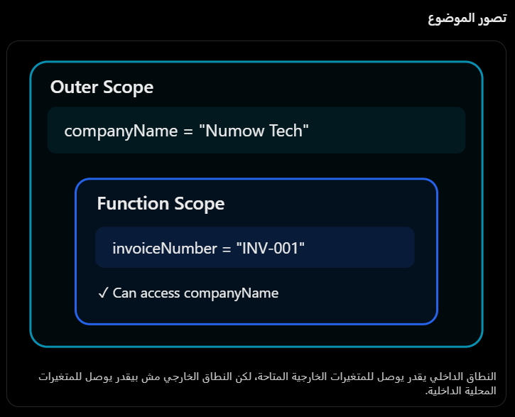

الدرس الجديد — Scope في 
JavaScript
1. يعني إيه Scope؟
الـ Scope هو النطاق اللي تقدر من خلاله توصل لمتغير معين.

يعني لما تكتب:
const companyName = "Numow Tech";

function createInvoice() {
    const invoiceNumber = "INV-001";

    console.log(companyName);
    console.log(invoiceNumber);
}

createInvoice();

الدالة تقدر تشوف companyName اللي براها، وتقدر تشوف invoiceNumber اللي جواها.

لكن لو كتبت خارج الدالة:
console.log(invoiceNumber);

هيظهر ReferenceError، لأن المتغير مش متاح خارج نطاق الدالة.

تصور الموضوع

النطاق الداخلي يقدر يوصل للمتغيرات الخارجية المتاحة، لكن النطاق الخارجي مش بيقدر يوصل للمتغيرات المحلية الداخلية.

2. الفرق بين Global وFunction وBlock Scope
في JavaScript عندنا أنواع مختلفة من النطاقات، وخلينا نركز على الثلاثة دول.
Global Scope
const taxRate = 0.14;

function calculateTax(price) {
    return price * taxRate;
}

taxRate متعرفة خارج الدالة في الـ Top-level Scope، والدالة تقدر تستخدمها.

ملحوظة: في JavaScript Modules، المتغيرات على المستوى الأعلى ليها Module Scope، مش Global Scope بالمعنى الحرفي.
Function Scope
function checkout() {
    const total = 500;
    var discount = 20;
}

console.log(total);    // ReferenceError
console.log(discount); // ReferenceError

حتى var مش بتخرج برا نطاق الدالة.
Block Scope
هنا الاختلاف المهم:
if (true) {
    let quantity = 5;
    const price = 100;
    var discount = 10;
}

console.log(quantity); // ReferenceError
console.log(price);    // ReferenceError
console.log(discount); // 10

ليه discount اشتغلت؟

لأن var مش Block Scoped. لو الكود ده في Top-level سكريبت عادي، discount هتفضل متاحة بعد الـ if.

أما let وconst فبيحترموا حدود {} الخاصة بالـ Block.

3. مقارنة مهمة مع Python
في Python:
if True:    quantity = 5print(quantity)  # 5

لكن JavaScript:
if (true) {
    let quantity = 5;
}

console.log(quantity); // ReferenceError

وده لأن if في Python مش بتنشئ Scope مستقل للمتغيرات، بعكس الـ Block Scope الخاص بـ let وconst في JavaScript.

ليه ده مهم ليك؟

لما تكتب كود فيه عمليات بيع ومخزون وصلاحيات، تقدر تخلي المتغيرات المؤقتة متاحة في جزء محدد فقط، بدل ما تكون منتشرة في أجزاء مختلفة من الدالة ويحصّل تعديل عليها بالغلط.

4. Lexical Scope — المفهوم الأهم
بص المثال:
const tax = 14;

function calculate() {
    console.log(tax);
}

function checkout() {
    const tax = 20;
    calculate();
}

checkout();

تتوقع النتيجة؟

ممكن تقول 20 لأن calculate() اتنادت من داخل checkout().

لكن النتيجة هي:
14

ليه؟

لأن JavaScript بتستخدم Lexical Scoping.

يعني الدالة بتحدد أماكن البحث عن المتغيرات بناءً على مكان تعريفها في الكود، مش مكان استدعائها.

calculate() اتعرفت خارج checkout()، فبتقرأ tax من النطاق الخارجي اللي اتعرفت فيه.

الـ tax = 20 موجودة في نطاق checkout()، ومش جزء من سلسلة النطاقات الخاصة بـ calculate().

وده الأساس اللي هنبني عليه فهم الـ Closures.
5. تطبيق عملي — POS وخصومات الفروع
تخيل إن فيه خصم عام للشركة، وفرع ليه خصم مختلف:
const discount = 10;

function calculateTotal(price) {
    return price - discount;
}

function branchCheckout() {
    const discount = 25;

    return calculateTotal(200);
}

console.log(branchCheckout());

البرنامج هيرجع 190 مش 175.

وده لأن calculateTotal بتستخدم الخصم الموجود في النطاق اللي اتعرفت فيه، مش خصم الدالة اللي استدعتها.

وده مثال مهم ليه الاعتماد على متغيرات خارجية في حسابات الفواتير ممكن يعمل Business Logic Bugs.

الأفضل غالبًا إنك تمرر الخصم بشكل صريح:
function calculateTotal(price, discount) {
    return price - discount;
}

function branchCheckout() {
    const discount = 25;

    return calculateTotal(200, discount);
}

console.log(branchCheckout()); // 175

كده الدالة بقت أوضح، وأسهل في الاختبار، ومش معتمدة على قيمة مخفية في Scope خارجي.

# جدول أنواع الـ Scope في JavaScript

| النوع          | معناه                                      | استخدامه في البيزنس          | أهميته                                                    |
| -------------- | ------------------------------------------ | ---------------------------- | --------------------------------------------------------- |
| Global Scope   | متغير متاح من النطاق العام                 | إعدادات عامة للتطبيق         | مشاركة القيم، لكن الإفراط فيه يصعّب التحكم                |
| Module Scope   | متغير خاص بملف JavaScript Module           | فصل منطق الفواتير عن المخزون | تنظيم المشروع ومنع تضارب الأسماء                          |
| Function Scope | متغير متاح داخل الدالة                     | حساب إجمالي فاتورة واحدة     | عزل البيانات المؤقتة بين العمليات                         |
| Block Scope    | متغير داخل `{ }` باستخدام `let` أو `const` | متغير مؤقت داخل شرط أو Loop  | منع الوصول غير المقصود للمتغيرات                          |
| Lexical Scope  | الدالة تبحث عن المتغيرات حسب مكان تعريفها  | دوال الحساب والـ Callbacks   | فهم مصدر القيم وتجنب أخطاء الاعتماد على نطاقات غير مقصودة |